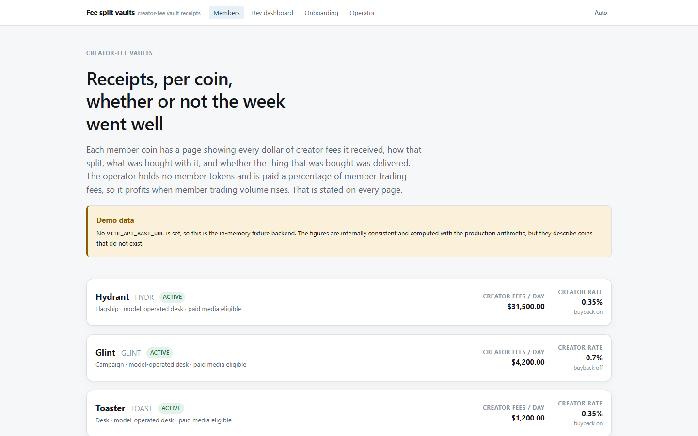

# fee-split-vaults-postmortem

A creator-fee vault protocol for tokens launched on an EVM launch venue, and the
on-chain market measurement that showed it should not be launched.

Each token gets its own vault. The token's creator points its fee recipient at
the vault, and the vault splits every credited fee three ways: a creator leg the
creator alone can withdraw, a promotion budget the creator dials, and an
operator share. The code, contracts and tests are complete. The measurement in
`tools/artifacts/VERDICT.md` returned STOP, so it was never deployed.



## The result

The question was whether the venue produces enough qualifying tokens to sustain
the operator's fixed costs. `tools/reprice.ts` answers it from measured inputs:

```
node tools/reprice.ts --tenure-days 11.59 --operator-bps 500 --clients-above-gate 73
! VERDICT: STOP
  feasibility ratio             : 0.68  (NOT ACHIEVABLE)
```

What the measurement over the venue's full 36-day V2 history found:

- 146 fee recipients cleared the qualifying gate, but only 73 were winnable.
  Break-even needed 109.
- 44% of the qualifying tokens had already pointed their fee recipient at
  per-token distributor contracts run by one partner launchpad. 95% of those
  contracts have no code path to change the recipient again, and over the whole
  history 0 tokens moved off one while 203 moved onto one.
- Mean tenure rose from 3.01 to 11.59 days once the 7-day window's truncation
  bias was removed. It did not change the answer, because tenure cancels out of
  the feasibility ratio.
- A 3-day recipient-change timelock, read from the venue factory, is not in the
  model. Carried through by hand it lowers the ratio to 0.50.
- Every figure was measured while the venue was subsidising gas. The re-run
  procedure for after the subsidy is in `tools/artifacts/OCTOBER-RERUN.md`.

Write-ups, newest first:

| File | Contents |
|---|---|
| `tools/artifacts/VERDICT.md` | The decision document: inputs, method, and why the earlier GO was withdrawn |
| `tools/artifacts/MEASUREMENT.md` | The original 7-day measurement and its method |
| `tools/artifacts/CURVE-SHAPE.md` | Bonding-curve fee shape, decoded from live logs |
| `tools/artifacts/OCTOBER-RERUN.md` | Exact command sequence to repeat the measurement |

The `.mjs` scripts next to them are the one-off analysis scripts that produced
those numbers. Their JSON outputs are gitignored.

## What is in the repository

```
contracts/            Foundry: CoinVault, VaultFactory, VaultDeployer, Registry,
                      ReceiptLog, VenueAdapter. Unit, red-team and invariant suites.
config/protocol.ts    Every economic parameter. Other code reads rates from here.
packages/core         Shared types and the airlock that untrusted input must pass.
packages/ledger       Double-entry attribution ledger.
packages/indexer      Chain ingestion and qualifying-fee measurement.
packages/broker       Deterministic spend gate: ordered pure checks, no model.
packages/screening    Content and fraud screening.
packages/runtime      Two-plane agent runtime (reader has no tools, planner only proposes).
packages/publisher    Post publishing; owns the disclosure string.
packages/pilot        Pre-registered experiment harness (power simulation, analysis).
packages/adapters     JSON-RPC, Postgres, Telegram, price feeds.
packages/*            Catalog, creative, desk, fleet, orchestrator.
apps/api              Control plane: consent, deployment, onboarding, receipts.
apps/web              Receipts site (Vite + React), with an in-memory demo backend.
ops/                  Scheduler, SQL migrations, monitoring, CI gates.
tools/                Measurement CLIs and the analysis artifacts above.
docs/                 Architecture, threat model, local running, operations.
```

Contract properties the tests check:

- The creator leg is pull-only to an immutable `DEV_PAYOUT`. `withdrawDev` and
  `pushDev` take no address argument.
- Budget pulls go only to the operator's own treasury against a countersigned
  invoice hash. There is no third-party payee parameter.
- Settlement does no swaps. Asset in equals asset out on the creator leg.
- Vault addresses are CREATE2-derived from the signed terms, and the TypeScript
  prediction (`tools/lib/deployment-derivation.ts`) is checked against the value
  Foundry computes (`contracts/test/unit/DerivedDeployment.t.sol`).
- The invariant suite (`contracts/test/invariant`) fuzzes deposits, splits,
  withdrawals, timelocks and suspension and checks solvency after every step.

## Getting started

Requires Node 22.18 or later and [Foundry](https://getfoundry.sh).

```bash
npm ci
npm run typecheck                 # tsc --build --force
npm run typecheck:tests           # test sources, which the build configs exclude
npm test                          # packages/ and apps/
npx vitest run --root ops         # scheduler, migrations, monitoring, CI gates
npx vitest run --config tools/vitest.config.ts
forge test --root contracts       # unit, red-team and invariant suites
```

Run the receipts site on its demo backend. No API, keys or chain access needed:

```bash
npm run dev -w @fee-split-vaults/web     # http://localhost:5273
```

Run the component demos. They use fixtures and scripted stand-ins for the
model, and say so in their output:

```bash
node tools/demo.ts broker      # spend gate: one approval, nine refusals at named gates
node tools/demo.ts desk
node tools/demo.ts screening
node tools/demo.ts all
```

Repeat the market measurement against a live RPC. Every tool takes
`--dry-run`, which prints the endpoints, block ranges and request budget
without making a request:

```bash
export VENUE_RPC_URL=https://rpc.mainnet.chain.robinhood.com
node tools/reprice.ts --help
```

`docs/RUNNING-LOCALLY.md` lists every environment variable the API reads.
`npm run bootstrap -- --dev-identity` writes a dev-only `.env.local` so
`npm run dev` can start the API and web app together.

## CI

`.github/workflows/ci.yml` runs on every push:

- `tsc --build`, test-source typecheck, the web app typecheck and a
  cross-package coherence check
- the import hygiene lint over `ops/`, `packages/`, `apps/` and `config/`
- vitest for `packages/` and `apps/`, `ops/` and `tools/`
- `forge build` and `forge test`, plus a deeper invariant run (512 runs, depth 64)
- a scan that fails if any file outside `config/protocol.ts` hardcodes a creator rate
- a working-tree secret scan
- migrations applied twice against Postgres 16, then the scheduler started
  against the migrated schema and refused against a pending one

## License

MIT. See `LICENSE`.
